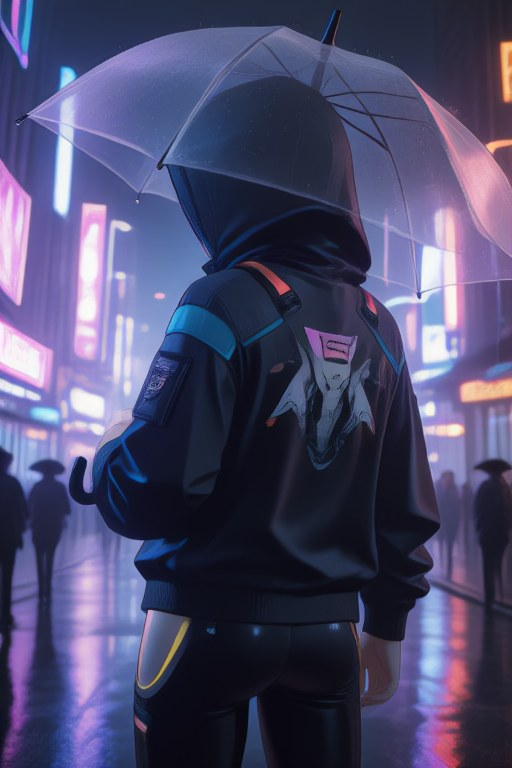
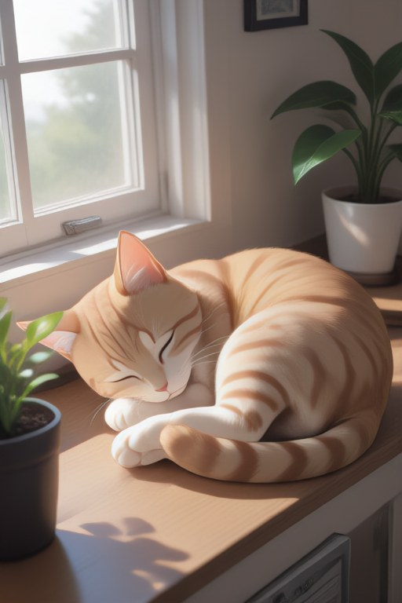
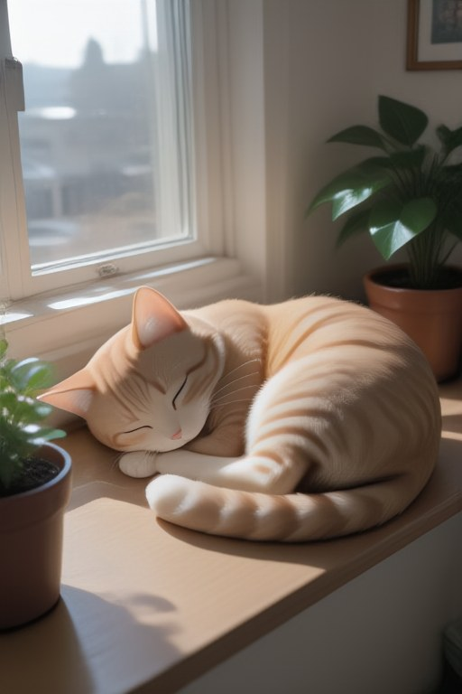
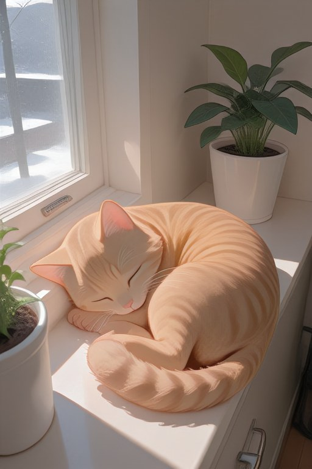
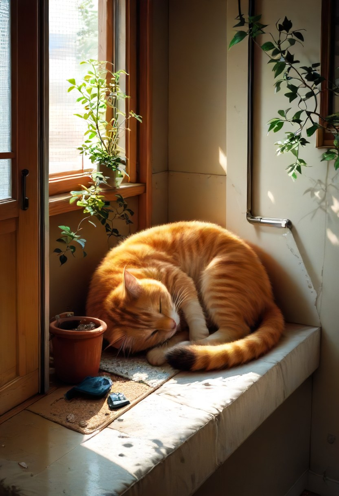
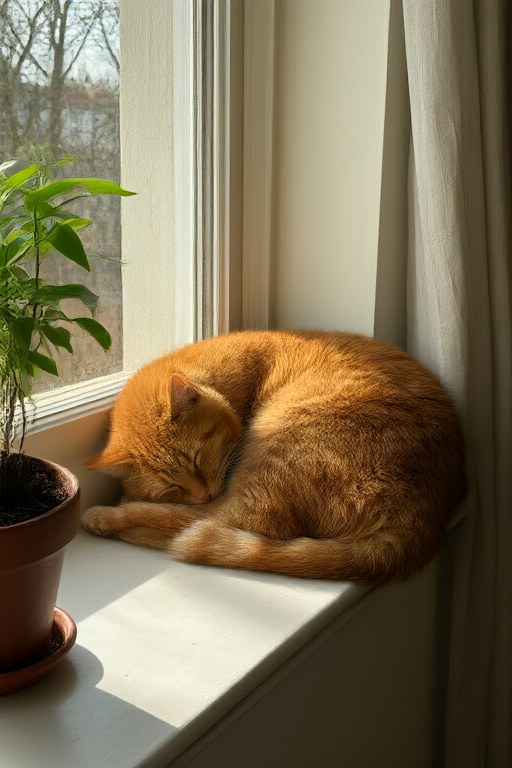
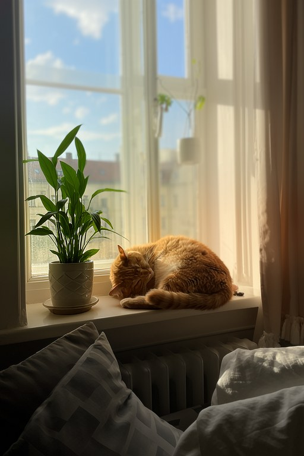

# Stable Diffusion на встроенной Vega 7: Anima, SDXL и другие модели через stable-diffusion.cpp

**Русский** · [English](README.md)

Локальная генерация картинок на ноутбуке без дискретной видеокарты через [stable-diffusion.cpp](https://github.com/leejet/stable-diffusion.cpp) (sd.cpp) на Vulkan. В репозитории:

- **Патчи** `patches/ggml-vega.patch` (ускорение ggml-vulkan на Vega/GCN, с тестами) и `patches/sd-cpp.patch` (правки sd.cpp: Anima, Wan VAE, выход FFN в UNet).
- **Скрипты** `scripts/build.sh` (сборка `sd-cli` и `sd-server`) и `scripts/download.sh` (официальные модели с проверкой SHA256).
- **Anima** `anima/gen-anima.sh` (командная строка) и `anima/merge_lora.py` (перевод в f16 и вшивание LoRA).
- **Интерфейс** `gui/`: окно на GTK 4 или веб-страница, очередь, живое превью, история, img2img, выбор сэмплера, планировщика и LoRA.
- **Апскейл** `tools/upscale.sh` (realesr-animevideov3, ×2 за ~1,6 с) и «живое фото» из ролика Wan `wan/cinemagraph.py`.
- **Питание** `power/`: таймер RyzenAdj для лимитов мощности.
- Подробный **журнал замеров**: что ускорило, что нет и почему.

## Железо

| | |
|---|---|
| Ноутбук | ThinkPad T14s Gen 1 |
| CPU | Ryzen 7 PRO 4750U |
| GPU | Radeon Vega 7 (Renoir, gfx90c): 7 CU, до 1600 МГц, без матричных ядер, без int8 dot и bf16 |
| ОЗУ | 16 ГБ DDR4, распаяна (ОС видит 14,3 ГиБ); GPU — 0,5 ГБ выделенной (BIOS) + общая память GTT (по умолчанию ~7,2 ГиБ, поднимается до 11 ГиБ, см. «Общая память и зависания») |
| ОС | Ubuntu 26.04, ядро 7.0, Mesa RADV 26.0 |

Теоретический пик GPU — 2,87 TFLOPS fp16. На практике умножение матриц выдаёт ~1,0–1,3 TFLOPS: шейдер занимает 128 регистров, это 2 волны на SIMD.

## Результаты

Время одной картинки, модель уже в памяти (интерфейс или `sd-server`), лимиты мощности RyzenAdj 25 Вт. Без охлаждающей подставки за длинную серию ноутбук доходит до 90 °C, и шаги идут до ~17% медленнее. Из командной строки добавляется загрузка весов, ~5–10 с.

| Модель и режим | Разрешение | Время |
|---|---|---|
| Anima 2B turbo, 4 шага, CFG 1, TAE | 384×576 | ~12 с |
| Anima 2B turbo | 512×768 | **~23 с** (шаги ~20 с, декодер ~1,6 с) |
| Anima 2B turbo | 920×1536 (родное) | ~2:05 |
| Anima 2.9B + Turbo-ANIMA V4-29B, 4 шага, CFG 1, TAE | 512×768 | ~33 с |
| SDXL (класс Illustrious) + DMD2, 4 шага, CFG 1, taesdxl | 832×1216 | **~38 с** (шаг 7,6 с) |
| SDXL + DMD2 | 1024×1536 | ~1:02 |
| Qwen-Image 2.1 Turbo (Q5_K_S), 8 шагов | 512×768 | ~3,5 мин |
| Kromoss (MOSS-Image 5B, Q6_K) + DMD2-LoRA, 4 шага | 512×768 | ~2 мин |
| Wan 2.2 TI2V 5B Turbo (Q4_K_M), 4 шага, 33 кадра | 512×768 | ~4:15 |
| Апскейл ×2 (realesr-animevideov3) | 512×768 → 1024×1536 | ~1,6 с |

Раньше патч настраивался на SD1.5 (аниме-чекпоинт, 20 шагов, CFG 7): 512×768 — ~80–85 с. Для сравнения, единственный найденный публичный замер на похожем железе — настольный Ryzen 5 5600G (Vega 7, 65 Вт), SD 1.4 через ROCm: ~3 с на шаг на 512×512 ([блог](https://www.gabriel.urdhr.fr/2022/08/28/trying-to-run-stable-diffusion-on-amd-ryzen-5-5600g/)); здесь в пересчёте на ту же работу ~2,5 с.

## Галерея

Одни и те же четыре SFW-сцены на каждой модели: рыцарь, горное озеро, ночной город, кот. Seed 42, первый результат без отбора и ретуши, везде CFG 1. Время на картинку с уже загруженной моделью (вместе с кодированием промпта и декодером); ноутбук без охлаждающей подставки, Tctl 84–98 °C, Anima и SDXL совпадают с таблицей результатов, а долгие Qwen-Image и Kromoss нагрели чип и вышли на 20–25% медленнее, чем там. Anima и SDXL шли через `sd-server` интерфейса, Qwen-Image и Kromoss через `sd-cli` (время `generate_image`, без загрузки).

| Модель и настройки | Рыцарь | Озеро | Город | Кот |
|---|---|---|---|---|
| **MiaoMiao 3D Harem (Anima 2B)**<br>+ Anima Turbo v1.1, 4 шага, euler / discrete, 512×768 | <br>24,2 с | <br>23,7 с | <br>24,2 с | <br>23,9 с |
| **MiaoMiao Anime Reality (Anima 2B)**<br>+ Anima Turbo v1.1, 4 шага, euler / discrete, 512×768 | <br>24,5 с | <br>23,9 с | <br>24,2 с | <br>24,4 с |
| **MiaoMiao RealSkin 1.3 (Anima 2B)**<br>+ Anima Turbo v1.1, 4 шага, euler / discrete, 512×768 | <br>24,2 с | <br>23,9 с | <br>24,2 с | <br>23,9 с |
| **MiaoMiao Harem 2.9B β1.1**<br>+ Turbo-ANIMA V4-29B, 4 шага, euler / sgm_uniform, 512×768 | <br>37,3 с | <br>38,8 с | <br>39,0 с | <br>38,3 с |
| **MiaoMiao RealSkin 2.9B 1.0**<br>+ Turbo-ANIMA V4-29B, 4 шага, euler / sgm_uniform, 512×768 | <br>39,1 с | <br>38,8 с | <br>39,0 с | <br>38,3 с |
| **JANKU v7.77 (SDXL, NoobAI)**<br>+ DMD2 LoRA на 4 шага (A1), 4 шага, euler_a / gits, clip skip 2, 832×1216 | <br>44,6 с | <br>38,8 с | <br>38,3 с | <br>38,6 с |
| **Qwen-Image 2.1 Turbo Q5_K_S**<br>8 шагов, euler, турбо-сигмы, taeqi2_1, 512×768 | <br>4:24 | <br>3:51 | <br>4:26 | <br>4:24 |
| **Kromoss (MOSS-Image 5B) Q6_K**<br>+ 8-steps DMD2 LoRA, 4 шага, euler, полный VAE FLUX.2, 512×768 | <br>2:27 | <br>2:27 | <br>2:26 | <br>2:21 |

У файнтюнов Anima турбо-LoRA вшита через `anima/merge_lora.py`; `download.sh` этого репозитория качает официальную `anima-turbo-v1.1` того же класса. ~24 с у Anima 2B, ~38 с у 2.9B и ~40 с у SDXL одинаковы для любого файнтюна того же размера.

<details><summary>Промпты</summary>

Anima / SDXL (теги booru; префикс качества у каждой модели свой, см. `gui/server.py`):

```
best quality, score_7, score_9, very aesthetic, ultra detailed, [photorealistic, raw photo, photo background,]
knight:  1girl, adult, solo, knight, silver armor, long red hair, holding sword, castle courtyard, banners, upper body, looking at viewer, determined
lake:    no humans, scenery, mountain lake, sunrise, pine forest, mist, wooden pier, reflection, clouds
city:    1boy, adult, solo, from behind, hooded jacket, transparent umbrella, cyberpunk city, night, rain, neon lights, neon sign, reflections, street
cat:     no humans, orange cat, sleeping, curled up, windowsill, sunlight, potted plant, cozy room
SDXL prefix: lazypos, masterpiece, best quality, general,
```

Qwen-Image / Kromoss (естественный язык):

```
knight:  An adult woman knight with long red hair in polished silver armor holding a sword, standing in a castle courtyard with banners, upper body, looking at the viewer with a determined expression
lake:    A calm mountain lake at sunrise surrounded by pine forest, morning mist, a wooden pier, clouds reflected in the water, no people
city:    An adult man in a hooded jacket with a transparent umbrella seen from behind on a cyberpunk city street at night, rain, neon lights reflecting on the wet road, a large neon sign that says "VEGA 7"
cat:     An orange cat sleeping curled up on a sunlit windowsill next to a potted plant in a cozy room
```

</details>

## Быстрый старт

### 1. Зависимости

```bash
sudo apt install build-essential cmake git libvulkan-dev glslc curl unzip python3-numpy
```

Для окна интерфейса нужны `python3-gi` с GTK 4 и libadwaita (на Ubuntu с GNOME стоят из коробки).

### 2. Сборка

```bash
scripts/build.sh
```

Скрипт клонирует stable-diffusion.cpp на коммите `4c870cc` (ggml `a5915eb`) в `build-src/`, накладывает оба патча и собирает статические `sd-cli` и `sd-server` с Vulkan. Результат — `tools/bin-opt-sd-cli` и `tools/bin-opt-sd-server`, ими пользуются скрипты и интерфейс. Заголовки SPIR-V ставятся в `build-src/prefix`, в систему ничего не устанавливается. Сборка шейдеров — несколько минут.

### 3. Модели

```bash
scripts/download.sh            # anima + upscaler
scripts/download.sh sdxl       # DMD2-LoRA и taesdxl для SDXL
```

| Группа | Файлы | Откуда |
|---|---|---|
| `anima` | `anima-turbo-v1.1` (4,2 ГБ, bf16 → переводится в f16), `qwen_3_06b_base` (текстовый энкодер, 1,2 ГБ), `qwen_image_vae` (254 МБ), `taew2_1` (22 МБ) | [circlestone-labs/Anima](https://huggingface.co/circlestone-labs/Anima), [madebyollin/taehv](https://github.com/madebyollin/taehv) |
| `sdxl` | `dmd2_sdxl_4step_lora_fp16` (376 МБ), `taesdxl` (9,8 МБ). Сам чекпоинт SDXL (любой класса Illustrious/NoobAI) положите в `sdxl/models/sdxl.safetensors` | [tianweiy/DMD2](https://huggingface.co/tianweiy/DMD2), [madebyollin/taesdxl](https://huggingface.co/madebyollin/taesdxl) |
| `upscaler` | realesrgan-ncnn-vulkan 20220424 (47 МБ) | [Real-ESRGAN v0.2.5.0](https://github.com/xinntao/Real-ESRGAN/releases/tag/v0.2.5.0) |

Для Anima 2.9B: модель на 40 блоков (например, [Anima-2.9B](https://huggingface.co/Gazingstars123/Anima-2.9B) или её доработки) и турбо-LoRA [Turbo-ANIMA V4-29B](https://civitai.com/models/2619830) вшиваются в один файл: `anima/merge_lora.py anima-2.9b.safetensors Turbo-ANIMA-v4-29B.safetensors anima/models/anima-2.9b_turbo4_f16.safetensors`. У этой LoRA alpha = ранг/2, скрипт это учитывает.

### 4. Лимит общей памяти (рекомендуется)

По умолчанию драйвер отдаёт GPU половину ОЗУ (~7,2 ГиБ). С 11 ГиБ помещаются SDXL с энкодерами на GPU, Anima 2.9B, видео Wan и декодирование без тайлов. В `GRUB_CMDLINE_LINUX_DEFAULT` в `/etc/default/grub` добавить `ttm.pages_limit=2883584 ttm.page_pool_size=2883584`, затем:

```bash
sudo update-grub
```

После перезагрузки `cat /sys/class/drm/card*/device/mem_info_gtt_total` должно показать 11811160064. Больше 11–11,5 ГиБ ставить не стоит: системе нужно оставить ~3 ГБ. Скрипты и интерфейс сами включают «тяжёлые» режимы только при лимите ≥ 10 ГиБ.

### 5. Интерфейс

```bash
gui/start.sh
```

Окно `gui/app.py` на GTK 4 (~110 МБ памяти против ~1–1,4 ГБ у вкладки браузера) или веб-страница `gui/start.sh --browser` (http://127.0.0.1:7860). Сервер `gui/server.py` — только стандартная библиотека Python; он держит один `sd-server` с выбранной моделью в памяти. Что умеет:

- модели: Anima 2B turbo, Anima 2.9B turbo, SDXL + DMD2 (в списке только те, чьи файлы есть на диске);
- разрешение с примерным временем, шаги, seed, количество; сэмплер и планировщик (рекомендованные отмечены ★); свои LoRA с весами (`anima/loras/`, `sdxl/models/loras/`, кнопка ⟳ перечитывает папку);
- очередь, живое превью, история с настройками, избранное, удаление в корзину (`gio trash`), автоапскейл ×2;
- img2img: исходник (файл, перетаскивание, Ctrl+V, картинка из истории) и сила изменения. Сила передаётся как уровень шума (`strength_as_noise_level`, `force_first_sigma`): штатно sd.cpp при 4 шагах даёт всего 3 уровня, а с 0,75 начинает с чистого шума.

Окно рисуется на CPU (`GSK_RENDERER=cairo`): с обычной Vulkan-отрисовкой GTK открытое окно даже в простое замедляло шаги на ~7% (5,39 против 5,05 с, A/B по три прогона). По той же причине во время генерации лучше свернуть браузер и Electron-приложения: свёрнутые окна не рисуют.

### 6. Командная строка

```bash
anima/gen-anima.sh "1girl, solo, red kimono, sitting by a river, smile" 4 -1 512x768
tools/upscale.sh --x2 anima/out/1793000000.png
```

Аргументы `gen-anima.sh`: `"промпт" [шаги=4] [seed] [ШxВ=512x768]`, `MODEL=` — другой файл из `anima/models/`, `VAE=full` — полный Qwen-Image VAE вместо TAE.

SDXL с DMD2 (что делает интерфейс):

```bash
tools/bin-opt-sd-cli -m sdxl/models/sdxl.safetensors --lora-model-dir sdxl/models/loras --taesd sdxl/models/taesdxl.safetensors \
  -p "masterpiece, best quality, 1girl, solo, ...<lora:dmd2_sdxl_4step_lora_fp16:1>" --cfg-scale 1 --sampling-method euler_a \
  --scheduler gits --steps 4 --clip-skip 2 -W 832 -H 1216 --diffusion-fa --eager-load -o out.png
```

Текстовые энкодеры CLIP-L/G на GPU (по умолчанию в sd.cpp) — 0,5 с на промпт против 2,5 с на CPU, но +1,6 ГБ видеопамяти (пик 9,5 ГБ на 1024×1536); при стандартном лимите GTT добавьте `--backend clip=cpu --params-backend clip=cpu`. Полный VAE SDXL здесь декодирует 30–76 с, `taesdxl` — 2,4–4,8 с.

## Anima: почему такие настройки

| Настройка | Зачем |
|---|---|
| Турбо-модель в f16 | у Vega нет bf16, поэтому веса один раз переводятся в f16 (`merge_lora.py … none …`). Для доработок Anima турбо-LoRA вшивается в веса заранее (`merge_lora.py`: W += alpha/rank·B·A), чтобы не применять её на каждом запуске |
| 4 шага, euler, CFG 1 | так обучена турбо-LoRA; на 6 шагах разница минимальная, на 2–3 картинка разваливается. CFG 1 — нет негативного прохода |
| `--backend clip=cpu` | текстовый энкодер Qwen3 0.6B считается на CPU: это ~1 с и экономит GPU-память для DiT |
| `--diffusion-fa` | flash attention; для головы 128 в патче подобраны свои параметры (см. ниже) |
| TAE `taew2_1` | облегчённый декодер: в ~3 раза быстрее полного VAE, на глаз почти то же. При стандартном лимите GTT — тайлы 128×128 (буфер 108 МБ; без тайлов ~2,6 ГБ на 512×768 вместе с весами **вешало ноутбук**). При лимите ≥ 10 ГиБ до 640×960 декодирует целиком — на 0,6–0,8 с быстрее |
| Полный VAE (`VAE=full`): тайлы 512×384 | если нужна максимальная точность декодирования |
| Разрешение 512×768 по умолчанию | родное 920×1536 даёт больше деталей, но ~3 мин на картинку; меньше 384×576 качество слишком низкое, такие размеры убраны из интерфейса (из командной строки доступны) |

**Что такое тайлы.** Декодер обрабатывает картинку кусками (тайлами) с перекрытием, а потом сшивает их. Пиковая память зависит от размера тайла, а не картинки. Перекрытие 0,25 прячет швы.

## Что делает патч ggml-vulkan

Патч к `ggml/` (`patches/ggml-vega.patch`: ggml-vulkan + одна правка в `ggml.c`), около 1200 строк вместе с тестами.

1. **Тайлы умножения матриц под GCN.** Тайл 64×64 на одну волну и 4×4 значения на поток. Большой тайл 128×128 включается только когда он ровно покрывает матрицу. В среднем 740 → 1000 GFLOPS на формах UNet. Действует только на AMD GCN.
2. **Flash attention для головы 40 (SD1.x).** Блок 16 строк на 4 группы без деления по D: самовнимание 54 → 43 мс, перекрёстное 6,3 → 2,9 мс. Попутно исправлен баг шейдера: при `row_split > 1` перестановки в подгруппе пересекали границы групп строк.
3. **Слияние нормализаций.** `group_norm → ×γ → +β [→ SiLU]` и `layer_norm → ×γ → +β` выполняются одним проходом (`group_norm_mul_add.comp`, `norm_mul_add.comp`). Стандартная проверка ggml отбрасывала in-place цепочки sd.cpp, поэтому добавлен свой сопоставитель.
4. **Слияние bias с умножением матриц.** `mul_mat → [reshape] → add(bias)` для линейных слоёв и свёрток: bias прибавляется в момент записи результата. Отдельных ADD за шаг 270 → 142.
5. **Свёртка без лишнего копирования.** При батче 1 `ggml_conv_2d` больше не делает бесполезный CONT после умножения.
6. **Тайловый im2col.** Перестановка 64×64 через общую память: чтение идёт вдоль строки картинки, запись вдоль CHW. На свёртках VAE в 2,6 раза быстрее (4,97 → 1,87 с на картинку). На UNet примерно без изменений (+0,3 с на картинку).

7. **Flash attention для головы 128 (Anima / Cosmos DiT).** Группа из одной волны (64 потока), блоки 16×16, `row_split=4`, `d_split=4`. Быстрее параметров по умолчанию на ~11% для самовнимания на 1,5 тыс. токенов, на ~22% для 5,5 тыс. токенов и на ~34% для внимания к 512 текстовым токенам. Найдено перебором; замеры — случаи Anima в `SD_UNET_PERF`.
8. **Исправление GQA.** Объединение голов при GQA проверяло максимальную долю по параметрам для 512 строк; с малыми блоками это давало неверный результат. Теперь проверяется `block_rows` для реального числа строк.
9. **Большой тайл при большом k (GCN).** Слой MLP вниз у Anima (k=8192) на среднем тайле 64×64 шёл всего 0,55 TFLOPS: с ростом k средний тайл с вдвое большим трафиком памяти теряет L2. Теперь при k ≥ 4096 выбирается тайл 128×128: 0,55 → 0,92 TFLOPS, сэмплирование 512×768 34,9 → 29,5 с (−15%), 920×1536 −12%, картинка бит-в-бит та же. Для этого селектор тайлов получает k (раньше передавался 0). Порядок обхода тайлов группами и split-K проверены — не помогают.
10. **Слияния для DiT (Anima), −8,5% на 512×768, картинка та же в пределах округления:**
    - adaLN `norm(x)·(1+scale)+shift` — одним проходом существующим слиянием NORM_AFFINE. Для этого `patches/sd-cpp.patch` пишет модуляцию как norm → mul → add и заранее добавляет scale/shift/gate в граф (иначе обход в глубину ставит MLP таймстепа между norm и mul).
    - RMSNorm коротких строк (q/k-нормы по головам, 128 столбцов): отдельный вариант шейдера на 64 потока вместо 512 — 3,5 → 0,85 мс на вызов.
    - Выход проекций `остаток + h·gate`: умножение на гейт и прибавление остатка в эпилоге `mul_mm` (binding 4, флаги `epi`). GELU в эпилоге пробовали: MLP-вверх замедлялся с 41 до 61 мс, поэтому GELU остаётся отдельным.
    - Слитый NORM_AFFINE держит строку (до 2048 значений) в регистрах между статистикой и выводом и идёт по 256 потоков на строку: 1,53 → 0,78 мс на вызов.
12. **Перекрёстное внимание только по настоящим токенам текста** (`patches/sd-cpp.patch`, `anima.hpp`): контекст дополняется нулями до 512 токенов, а проекции K/V без bias и RMS-норма ключей оставляют нулевые строки нулевыми — поэтому K/V считаются только для реальных токенов промпта и дополняются нулями после. Бит-в-бит (CPU и GPU), сэмплирование 512×768 23,0 → 22,9 с (−0,6%).
11. **TAE (taew2_1) без лишних кадров** (`patches/sd-cpp.patch`, `tae.hpp`): видео-декодер дважды удваивает число кадров и потом оставляет последний; после блоков памяти последнего слоя всё покадровое, поэтому ненужные кадры отбрасываются до апсемпла — свёртки на полном разрешении считают 1 кадр вместо 4. Декодирование 512×768 2,81 → 2,47 с, 920×1536 9,55 → 8,24 с, картинка бит-в-бит. (Без тайлов на 512×768 — 1,66 с, но буфер 1,5 ГБ рядом с 4 ГБ весов слишком близко к стандартному пределу GTT; при поднятом до 11 ГиБ лимите интерфейс и `gen-anima.sh` декодируют без тайлов до 640×960, см. ниже.)
13. **FA без проверки границ на полных блоках** (`flash_attn.comp`, `flash_attn_block.glsl`). Когда длина KV не кратна блоку (16 у Anima), весь шейдер шёл в варианте с проверкой границ, на ~60% медленнее: при 448×672, 576×864, 704×1056, 832×1248 число токенов `(W/16)·(H/16)` не кратно 16. Тело цикла по блокам KV вынесено в файл и включается дважды: полные блоки без проверок, только последний — с проверками. Внимание на 2904 токена 196 → 122 мс, на 4056 — 354 → 200 мс; через интерфейс 576×864 40,9 → 36,3 с, 704×1056 69,3 → 60,0 с, 832×1248 103,4 → 86,6 с. Картинка та же в пределах округления. Проверку только в последнем блоке через переменную во время выполнения пробовали — медленнее (210 мс): компилятору нужна константа. Блок 8 (делит все такие длины) — 135 мс, сам по себе на ~28% медленнее блока 16.
14. **Слияние RMSNorm → ×w → RoPE (+ приведение к f16)** (`rms_norm_mul_rope_apply.comp`). q/k-нормы самовнимания и `ROPE_APPLY` из sd.cpp идут одним проходом: одна рабочая группа на строку (голова, токен), сумма квадратов и арифметика как у несслитых шейдеров — картинка бит-в-бит. Для k слитый шейдер сразу пишет f16 для FA. Раньше это слияние отменяла проверка перекрытия: выход RoPE переставлен (головы ↔ токены), а распределитель клал его на место входа. Теперь `anima.hpp` держит исходные q/k в `src[2]` у RoPE (и у приведения k к f16), и они живут до конца слитой операции. Попутно: `ggml_can_fuse` требует одинаковой формы по цепочке (у RoPE она другая) и отвергает MUL на месте (вид выхода RMS_NORM), поэтому проверка своя; проверка перекрытия пропускает самоссылку `ggml_cast` в `src[1]`. За шаг 512×768: 125 → 50 мс.
15. **Входы умножений в f16, слитые в NORM_AFFINE и GELU** (`norm_mul_add.comp` с выходом f16, `gelu_f32_f16.comp`). Шейдер умножения и так округляет вход B до f16 (веса f16), поэтому `anima.hpp` приводит к f16 выходы трёх adaLN и GELU в MLP — результат бит-в-бит (и на CPU), а умножения с f16-входом быстрее на 5–12% (меньше трафика). Приведение сливается в нормализацию/GELU, отдельных копий нет; GELU с выходом f16 пишет по 4 значения на поток (через общий `unary.comp` по 2 байта на поток было медленнее f32). 8 шагов 512×768 с остыванием перед каждым прогоном: 46,0 → 44,5 с (три пары из трёх).
16. **FA для головы 64 (SDXL)** (`get_fa_tuning_params_scalar`). Параметры flash attention подбирались только под головы 40 и 128; у UNet SDXL голова 64, и внимание шло на 370–460 GFLOPS (22% шага). Перебор ~30 комбинаций на формах SDXL 832×1216 (`SD_UNET_PERF=1`): `Br=16, Bc=32, WG=128, row_split=4, d_split=4`. Самовнимание на 3952 токена 104 → 62 мс, на 988 — 9,9 → 7,3 мс, перекрёстное к 77 токенам 1,74 → 0,98 мс; внимание за шаг 1,77 → 1,15 с. Полная генерация A/B (старый/новый бинарник поочерёдно): шаг 8,42 → 7,85 с, 4 шага 38,3 → 36,0 с. Картинка та же в пределах округления (другой порядок суммирования). Все 5332 теста FLASH_ATTN_EXT проходят.
17. **Выход FFN без f32-накопления** (`patches/sd-cpp.patch`, `block.hpp`). sd.cpp на Vulkan включал для `ff.net.2` в UNet накопление в f32 — защиту от переполнения f16, но это отдельный шейдер, в 1,5 раза медленнее (SDXL: 736 против 1150 GFLOPS). Теперь на Vulkan вход масштабируется на 1/128 и умножение идёт в f16 (как в sd.cpp для CUDA с k-квантами, «precision_fix»). Шаг SDXL 832×1216 −2…2,3% (пять промптов, A/B в каждой паре, включая 896×1152 и 1024×1536, три разные 4-шаговые DMD2-LoRA); NaN нет, картинка та же в пределах округления (средняя разница 5–14 из 255).

Правки 1, 2, 7 и 9 включаются только на AMD GCN. Остальные работают на любом GPU с Vulkan.

### Патч sd.cpp (`patches/sd-cpp.patch`)

- **Перекрёстное внимание через sink** (`anima.hpp`, `ggml_extend.cpp`): текстовый контекст в модели дополняется нулями до 512 токенов. Нулевой ключ даёт оценку 0, то есть добавляет e⁰ = 1 в знаменатель softmax и ничего в числитель. Ровно это делает «sink» FA (`ggml_flash_attn_ext_add_sinks`) со значением ln(число нулевых токенов) на голову, поэтому внимание считается только по реальным токенам (~40–110 вместо 512). Без FA то же через `ggml_soft_max_add_sinks`. Картинка та же в пределах округления (CPU: максимум 2/255). Перекрёстное FA за шаг 512×768: 271 → 53 мс, вся картинка −1,3 с.
- **Кеш K/V текста между шагами** (`anima.hpp`): адаптер и K/V перекрёстного внимания зависят только от промпта. Первый шаг кладёт K (после нормы) и V всех 28 блоков в кеш раннера в f16 (FA всё равно приводит их к f16), следующие шаги берут их оттуда и вообще не строят адаптер и проекции контекста. Ключ — хеш контекста, t5_ids и весов, так что при CFG у позитива и негатива свои записи; кеш сбрасывается в `end_runners()` на каждой генерации. Бит-в-бит (GPU, CPU, CFG 2); 8 шагов с остыванием: 44,1 → 43,8 с (~0,13 с на 4 шагах).
- **Без лишних копий перед FA** (`ggml_extend.cpp`): при батче 1 q и k отдаются в FA переставленными видами (FA работает с шагами), а V переставляется сразу при приведении к f16 — одна копия вместо двух. −45 мс за шаг, бит-в-бит.
- **LoRA в формате kohya для Anima** (`name_conversion.cpp`): в именах `lora_unet_llm_adapter_…` подчёркивание в `llm_adapter` превращалось в точку, и LoRA адаптера текста молча не применялась (у одной из стилевых LoRA применялись 840 из 948 тензоров). `llm_adapter` добавлен в защищённые токены.
- Wan VAE (у Anima это Qwen-Image VAE) — видео-VAE с причинными 3D-свёртками. Для одного кадра без кэша паддинг по времени нулевой, и от ядра работает только последний временной срез. Патч в `CausalConv3d::forward` в этом случае делает обычную 2D-свёртку этим срезом вместо 3D. Результат тот же, декодирование быстрее и легче по памяти.

### Проверка

В `tests/test-backend-ops.cpp` добавлены тесты `GROUP_NORM_AFFINE`, `NORM_AFFINE` и `MUL_MAT_BIAS` (в том числе свёрточный случай и split-K), а также набор замеров форм UNet под переменной `SD_UNET_PERF=1`. Все тесты проходят:

| Тест | Пройдено |
|---|---|
| MUL_MAT | 2279 / 2279 |
| MUL_MAT_ID | 939 / 939 |
| FLASH_ATTN_EXT | 5332 / 5332 (после правок 7–8) |
| CONV_2D | 1966 / 1966 |
| IM2COL | 102 / 102 |
| MUL_MAT_BIAS | 11 / 11 |
| NORM / GROUP_NORM / *_AFFINE / *_MUL_ADD | все |
| ADD / MUL / SILU | все |
| `test-conv2d`, `test-conv1d` | PASSED |

Запуск тестов в собранном дереве:

```bash
build-src/stable-diffusion.cpp/build/bin/test-backend-ops test -b Vulkan0 -o MUL_MAT_BIAS
```

`test-backend-ops` собирается отдельно (`cmake --build build --target test-backend-ops`).

## Другие модели и видео (замеры, в интерфейс не входят)

Всё на этом ноутбуке, GTT 11 ГиБ, тот же патченый ggml. Скриптов запуска для этих моделей в репозитории нет (кроме `wan/cinemagraph.py`) — записаны команды-рецепты в виде флагов и результаты.

| Модель | Файлы | Время | Вывод |
|---|---|---|---|
| **Qwen-Image 2.1 Turbo** (7B, 8 шагов, CFG 1, `--sigmas qwen-image-2.1-turbo`) | `qwen-image-2.1-turbo-Q5_K_S.gguf` (unsloth, 4,5 ГБ), `Qwen3VL-8B-Instruct-Q4_K_M.gguf` на CPU, `taeqi2_1` | 512×768 — 212 с (шаг 26 с, энкодер 1,9 с, декодер 0,24 с) | Надписи на картинке правильные. Профиль шага: умножение матриц 84% (Q4_K/Q5_K на 0,75–1,1 TFLOPS — столько же, сколько f16), внимание 6,8%. Слои Q5_K медленнее Q4_K (875 против 1078 GFLOPS) — чистый Q4_K_M дал бы ~3%. VAE ускорять некуда |
| **Kromoss** (MOSS-Image 5B, lodestones) + `8-steps-dmd2-lora` (CFG 1) | `kromoss-Q6_K.gguf` (molbal), `Qwen3.5-9B-Q4_K_M.gguf` на CPU + `tokenizer.json`, `flux2-vae_small` | 512×768: 8 шагов — 3,6 мин, 4 шага — ~2 мин (качество почти то же) | sd.cpp сам раскладывает раздельные q/k/v LoRA по слитому `qkv` (756/756 тензоров). На квантованной модели LoRA применяется на лету: шаг 25 с против 21 с без неё (+17%); вшить её можно только в bf16/f32 с повторным квантованием. Полный VAE 10,5 с, лёгкого декодера для FLUX.2 VAE в sd.cpp нет. Иногда рисует надпись-водяной знак в углу |
| **Wan 2.2 TI2V 5B Turbo** (4 шага, CFG 1) | `Wan2_2-TI2V-5B-Turbo-Q4_K_M.gguf` (hum-ma, 3,4 ГБ), `umt5-xxl-encoder-Q4_K_M.gguf` на CPU, `taew2_2` | 33 кадра (1,4 с видео): 480×832 и 512×768 — ~4:15 (шаг ~57 с, ~15 мс на латентный токен), 49 кадров — ~5 мин | На 352×640 и меньше — брак (квадраты 32 px, и в стоковой сборке тоже): модель обучена на ~704p. Image-to-video из картинки Anima держит стиль и лицо. 49 кадров без `--vae-tiling --temporal-tiling` съели всю память при декодировании и подвесили ноутбук. K-кванты шли почти как в стоковой сборке (123 против 129 с) |
| Wan: петля и «живое фото» | `--end-img` = `-i` (одна картинка в начале и в конце) | как выше | Последний латентный кадр (4 видеокадра) декодируется бледным — его отбрасывают. «Живое фото» (`wan/cinemagraph.py`): кадры Wan только внутри маски персонажа, фон — исходник пиксель в пиксель; моргать по просьбе Wan не стал, поэтому моргание вклеивается из исходника с закрытыми глазами (инпейнт Anima по маске глаз, 7 кадров). Автомаска по движению срабатывает не всегда — на тихих петлях лучше нарисованная маска |
| LTX-2.5 (22B) | — | не запускали | Самый маленький квант 7,3 ГБ (Q2_K), с энкодером Gemma 4 12B (~7 ГБ в Q4) в 14 ГБ ОЗУ не помещается; с подгрузкой весов с диска по оценке 10–30 мин на 2-секундный ролик |

## Журнал экспериментов: что не помогло

Строки про CFG, планировщики, кэши шагов, эмбеддинги и негативы относятся к SD1.5 (аниме-чекпоинт, 20 шагов, CFG 7).

| Идея | Результат |
|---|---|
| ucache в режиме качества | −42% времени, но ломает мелкие детали и анатомию, появляются лишние руки |
| Кэш spectrum | −30% времени, грубые артефакты цвета |
| Планировщик AYS, 14 шагов | −25% времени, качество почти то же, но мелкие текстуры хуже; оставлен Karras |
| AYS, 10 шагов | заметно площе и беднее деталями |
| CFG 1 на последних 10 шагах | бледнее и площе; оптимум — 6 шагов |
| Hires fix (latent, ×1,5) | качество как на Civitai, но 325 с вместо 107; без hires разница небольшая |
| Предвыборка тайла в шейдере умножения | медленнее на 9%: 128 → 176 регистров, 2 → 1 волна на SIMD |
| ROCm (ночная сборка TheRock gfx900 + `HSA_OVERRIDE_GFX_VERSION=9.0.0`) | заработал только с рантаймом HSA из Ubuntu; в 3,5 раза медленнее Vulkan, повесил систему |
| Квантование весов (q8/q4) | не поможет: умножение упирается в вычисления, а у Vega нет int8 dot (`int dot: 0`) |
| Негативные эмбеддинги EasyNegative и bad-hands-5 | скорость та же, но устойчивого улучшения рук и анатомии нет: картинка меняется примерно как от другого seed (4 промпта, A/B) |
| Профиль питания `performance` и DPM `high` | частоты GPU и памяти на максимуме (1600/1333 МГц), но генерация на ~10% медленнее, чем на `balanced` + `auto`; `performance` + `auto` — хуже всего |
| `GGML_VK_ALLOW_GRAPHICS_QUEUE=1` | около 2%, может подтормаживать интерфейс |
| Апскейлер: тайлы 64 / 256 / 384, прямые свёртки | 32,5 / 38,5 / 44,5 / 31,6 с против 29,6 с у тайла 128 по умолчанию |
| ROCm для Anima | то же, что выше: Vulkan быстрее, ROCm удалён |
| Декодирование Anima полным VAE прямыми свёртками | мусор на выходе; `--offload-to-cpu` падает |
| TAE `taew2_1` без тайлов на GPU (512×768) | буфер 2,6 ГБ + веса — память кончилась, ноутбук завис. Только с тайлами |
| TAE с тайлами 256 / 512 / 64 | 128 — лучший компромисс: 64 медленнее и заметнее швы, 256+ съедают память |
| Cosmos LoRA вместо Anima Turbo | хуже на 4 шагах, удалена |
| Turbo v0.2 → v1.1 (4 и 8 шагов, 4 промпта) | качество примерно равное: v1.1 чище и с более чёткими контурами, v0.2 насыщеннее и разнообразнее; выбрана v1.1. 8 шагов детальнее у обеих, но вдвое дольше |
| Турбо-LoRA на 1–2 шагах | картинка разваливается |
| MIGraphX / rocBLAS (ROCm 7.2, распакован без sudo, ядра gfx900 из 6.3.4, заглушка hipblaslt) | ROCm запустился; rocBLAS fp16 до 1,51 TFLOPS на крупных формах, но на 512×768 суммарно медленнее нашего Vulkan на ~37%; переход на MIGraphX не стоит портирования |
| Обход тайлов группами (swizzle) в `mul_mm`, split-K для k=8192 | без выигрыша или медленнее |
| Ускорение `mul_mm`: перебор тайлов, предвыборка в регистры, раскладка A парами строк, B в fp16 | 0–4%: шейдер упирается в задержки памяти (2 волны на SIMD), а не в вычисления; на 512×768 он и так ~2× быстрее rocBLAS |
| IREE 3.13 (Vulkan, цели `cdna1`/`rdna1`; GCN-целей нет) | 0,03–0,40 TFLOPS против 1,0–1,43 у ggml |
| TVM (MLC 0.26): dlight 0,14–0,31 TFLOPS; автоподбор MetaSchedule | 0,64 TFLOPS за 32 попытки, и случайные ядра дольше 2 с **сбрасывали GPU** (экран гас, сессия вылетела) — не запускать без поднятого таймаута |
| ToDo: сжатие K/V 2×2 в самовнимании (выборка, усреднение, усреднение до RoPE с центром клетки и перенормировкой) | −7% на 512×768, −24% на 920×1536, но блоки/мыло/развал картинки в любом варианте: в DiT нет свёрток, локальные детали идут только через внимание |
| ToMA (упрощённый: тайлы 4×4, опорные токены через один, soft-слияние τ=0,01) | во всех или последних блоках — пикселизация; только средние блоки 8–17: −15%, 4–19: −24…26%, но мягче, ниже контраст, теряются мелочи — отвергнуто |
| AMDVLK 2023.Q3.3 (последний официальный Vulkan-драйвер AMD с Vega; компилятор LLPC/LLVM; подключался через `VK_ICD_FILENAMES` без установки) | умножение матриц 0,12–0,22 TFLOPS против 1,0–1,43 у RADV (в 6–8 раз медленнее), общая память 32 КБ вместо 64, тест flash attention уронил GPU (`DeviceLost`) |
| Mesa 26.2.5 (RADV собран локально, с libdrm 2.4.133, через `VK_ICD_FILENAMES`) вместо системной 26.0.8 | тесты проходят; микрозамеры MLP-вверх/FA +3–6%, но полная генерация **медленнее на 2–4%** (512×768: 26,4 → 27,1 с; 920×1536: 133 → 139 с) |
| Правка компилятора ACO (Mesa 26.0.8, локальная сборка): окна/лимиты перестановок планировщика для LDS, VMEM, клауз; потолок VGPR 84 ради 3 волн | значения по умолчанию лучшие; без планировщика −35%; при 84 VGPR средний тайл всё равно 2 волны (упор в LDS 8,7 КБ), большой получает 3 волны, но с вытеснением регистров медленнее (1,08 → 1,01 TFLOPS) |
| Внимание без FA на 512×768 (обычные умножения + softmax) | 28,9 с против 24,2 с — медленнее |
| Flash attention с накоплением в f16 (`GGML_PREC_DEFAULT`) | FA +14%, шаг ~−2%, картинки на глаз те же, но риск переполнения f16 на редких промптах — оставлено f32 |
| TAE без тайлов при стандартном GTT 7 ГиБ | декодирование 2,42 → 1,66 с на 512×768, но вместе с 4 ГБ весов слишком близко к пределу (ноутбук зависал); включается само только при GTT ≥ 10 ГиБ |
| TAE без тайлов на 768×1152 и больше / тайлы 256 и 384 px | 768×1152: 5,45 → 6,29 с (медленнее), пик 8,5 ГБ; крупные тайлы — в пределах шума |
| TAE: тайлы 192/256, прямые свёртки | 192: −5% декодирования; 256 и прямые свёртки медленнее |
| Пачка картинок (`-b 2`), кэш текстового энкодера | sd.cpp считает пачку циклом; кодирование промпта 0,12 с — выигрыша нет |
| Слияние RMSNorm(q/k) → ×w → RoPE в один шейдер | тесты проходят, но в графе Anima распределитель кладёт выход RoPE в буфер входа, а выход RoPE переставлен (головы ↔ токены) — слитый шейдер затирал бы непрочитанные строки, проверка перекрытия в ggml отменяет слияние (и вместе с ним RMSNorm+MUL). Откачено |
| Упакованный fp16 FMA в `mul_mm` (llama.cpp PR #29877) | уже есть в нашем ggml: в машинном коде только `v_pk_fma_f16` |
| Блокирующее ожидание GPU вместо активного опроса в конце графа | CPU во время шагов 1,3 ядра → ~0,5, но время то же: GPU упирается не в общий лимит мощности |
| Перебор параметров FA для перекрёстного внимания (KV ~107) | текущие Br16 Bc16 WG64 лучшие; остальные в 1,1–9 раз медленнее |
| V в FA в f32 (без приведения к f16) | FA +2,9 мс против 0,8 мс на копию — хуже |
| Перекрёстное внимание как P·(V·W_o) (k = 16·длина текста вместо 2048) | выигрыш только для коротких промптов; при типичных ~90–110 токенах ~0,15 с — не делали |
| Накладные расходы тайлов декодера | 40 тайлов по ~58 мс почти целиком GPU; подготовка графов ~0,1 с на всё декодирование |
| FA с выходом в f16 (слитое приведение для выходной проекции) | проекция −0,77 мс, но самовнимание +1 мс за вызов: в сумме ~−13 мс за шаг, в общем времени не видно — откатили |
| Эпилог «гейт + остаток» без целочисленных делений индекса | время то же: эпилог стоит ~0,5 мс, а разница с обычным умножением была из-за f32-входа |
| Тайлы для f16-входа | большой тайл для k=8192 по-прежнему лучше среднего (50–59 против 79–86 мс), выбор не меняли |
| SDXL: тайл для выхода FFN (1280×988, k=5120; 640×3952, k=2560) | в профиле 736–810 GFLOPS против 1150–1320 в отдельном тесте, но тайл уже лучший и в графе (средний медленнее: 21 против 17,5 мс). Причина — накопление в f32, которое sd.cpp включал на Vulkan для `ff.net.2`; заменено на масштаб входа 1/128 (см. пункт 17). f16 вовсе без защиты — −3,5%, но с риском NaN, не включали |
| Отключить живое превью в интерфейсе (`preview: none`) или делать его один раз вместо шагов 2 и 4 | 23,2–24,6 с на 512×768 во всех вариантах, разница в шуме: превью (`proj`) ничего не стоит |
| Qwen-Image 2.1 Turbo: 6 и 4 шага вместо 8 (прорежённое турбо-расписание) | 157 и 105 с вместо 209 с, сцена почти та же, но надписи на картинке разваливаются — а текст и есть главное, ради чего эта модель |
| A/B без подставки | разброс ±1 с из-за нагрева; сравнивать только с остыванием до <55 °C перед каждым прогоном и по 8 шагов, или по профайлеру операций (но он ставит барьеры и может обманывать) |

## Питание: лимиты мощности (RyzenAdj)

Видеокарта упирается не в температуру, а в лимит мощности всего чипа: CPU и GPU делят один бюджет. Телеметрия (`/sys/class/drm/card1/device/gpu_metrics`) во время генерации 512×768 на подставке:

| Настройка | Шаги | Мощность | GPU | Память (fclk) | Темп. |
|---|---|---|---|---|---|
| «Сбалансированный», лимиты Lenovo (STAPM 20, PPT slow **15**, fast 20 Вт) | 28,2 с | 15,3 Вт | 1416 МГц | 800 МГц | 47 °C |
| «Производительность» | 32,9 с | 10,6 Вт | 1118 МГц | 800 МГц | 43 °C |
| «Энергосбережение» | 32,9 с | 10,4 Вт | 1114 МГц | 800 МГц | 42 °C |
| **RyzenAdj 25/25/30 Вт, Tctl 90** | **25,7–26,0 с** | 19,5 Вт | 1588 МГц | 800 МГц | 50–54 °C |
| RyzenAdj + `power_dpm_force_performance_level=high` | 25,6 с | 20,5 Вт | 1593 МГц | 1333 МГц | 54–59 °C |
| RyzenAdj + `manual` (память застряла на 400 МГц) | 35,0 с | 16,6 Вт | 1595 МГц | 400 МГц | 50 °C |

- Профиль «Производительность» на T14s Gen 1 AMD работает как энергосбережение (прошивка). Используйте «Сбалансированный».
- Выше 1600 МГц GPU не разгоняется (`pp_od_clk_voltage`: диапазон 200–1600), поэтому лимит выше 25 Вт не нужен.
- Частота памяти 1333 вместо 800 даёт ~1,7%, а `high` держит всё на максимуме и в простое — не используем.

Установка (нужен sudo; RyzenAdj собирается из [FlyGoat/RyzenAdj](https://github.com/FlyGoat/RyzenAdj) v0.19.0, нужен `libpci-dev`):

```bash
sudo install -m 755 ryzenadj /usr/local/bin/ryzenadj
sudo install -m 644 power/ryzenadj-limits.service power/ryzenadj-limits.timer /etc/systemd/system/
sudo systemctl daemon-reload && sudo systemctl enable --now ryzenadj-limits.timer
```

Таймер применяет лимиты через 15 с после загрузки и затем раз в минуту (прошивка может сбрасывать их после сна или смены профиля). Отключить: `sudo systemctl disable --now ryzenadj-limits.timer`.

## Подводные камни

### Таймаут драйвера amdgpu (2 секунды)

Драйвер сбрасывает задание GPU, если оно выполняется дольше 2 секунд (`lockup_timeout`, по умолчанию 2000 мс). На 896×1344 и больше одно вычисление внимания длится дольше, и генерация падает с `ErrorDeviceLost`. Это касается и исходной сборки. Поднять таймаут только для вычислений (нужен sudo и перезагрузка):

```bash
echo 'options amdgpu lockup_timeout=0,30000,0,0' | sudo tee /etc/modprobe.d/amdgpu-timeout.conf
```

```bash
sudo update-initramfs -u
```

### Общая память и зависания

GPU и CPU делят 16 ГБ. Если веса модели (Anima f16 — 4,2 ГБ) и буферы вычислений вместе превышают лимит GTT, система не падает с ошибкой, а **намертво зависает**, помогает только перезагрузка. Так было с TAE без тайлов на 512×768 при стандартном лимите, с ROCm, с двумя моделями сразу (интерфейс и `sd-cli`) и с 49 кадрами видео без декодирования по частям. Поэтому: не запускать две генерации одновременно (интерфейс держит один `sd-server`, `gen-anima.sh` и сервер отказываются стартовать рядом с другим процессом), новые разрешения пробовать сначала на малом размере. Память GPU не ограничивается `systemd-run -p MemoryMax`. Зависший `sd-cli`/`sd-server` держит гигабайты GTT: проверьте `pgrep -a 'sd-(cli|server)'` перед запуском.

Предел GTT — это не железо, а настройка драйвера: по умолчанию половина ОЗУ (`ttm.pages_limit`). Её можно поднять до 11 ГиБ, дописав в `GRUB_CMDLINE_LINUX_DEFAULT` в `/etc/default/grub` `ttm.pages_limit=2883584 ttm.page_pool_size=2883584`, затем `sudo update-grub` и перезагрузка; проверка — `cat /sys/class/drm/card1/device/mem_info_gtt_total` (11811160064). Скорость от этого не растёт, но интерфейс и `gen-anima.sh` при GTT ≥ 10 ГиБ декодируют до 640×960 без тайлов, на 0,6–0,8 с быстрее (пик 7,0 ГБ на 640×960; на 768×1152 без тайлов уже медленнее). Память GPU не ограничивается `MemoryMax` в systemd, поэтому системе, браузеру и текстовому энкодеру нужно оставить ~3 ГБ: больше 11–11,5 ГиБ ставить не стоит.

### Прогрев

После часа непрерывной генерации сэмплирование замедляется примерно на 8% (71 → 77 с). Режим питания «Производительность» и хорошее охлаждение помогают.

### Hires fix

sd.cpp умеет его сам: `--hires --hires-upscaler "Latent (nearest-exact)" --hires-denoising-strength 0.55`. Отдельный апскейлер не нужен, так делают авторы картинок на Civitai. Больше 768×1152 упирается в таймаут выше, а VAE на таком размере нужно декодировать по тайлам (`--vae-tiling`).

## Профилирование

Время каждой операции GPU по шагам:

```bash
GGML_VK_PERF_LOGGER=1 tools/bin-opt-sd-cli ... 2> perf.txt
```

Замеры форм UNet:

```bash
SD_UNET_PERF=1 build-src/stable-diffusion.cpp/build/bin/test-backend-ops perf -b Vulkan0 -o MUL_MAT
```

Статистика регистров и волн для шейдеров:

```bash
RADV_DEBUG=shaderstats,nocache ...
```

Типичная раскладка одного прохода UNet на 512×768: умножение матриц 57%, внимание 20%, im2col 6%, остальное — мелочи. У Anima ещё больше упирается в умножение матриц, то есть в потолок железа.

## Открытые направления

- Прямые свёртки (`conv2d direct`) на Vega не проходят проверку sd.cpp и выключены, всё идёт через im2col: в декодере taesdxl im2col — 60% времени, в шаге SDXL ~3,5%.
- Дистилляция Anima в 2 шага, слияние токенов с приемлемым качеством, адаптеры большего текстового энкодера для Anima (есть только для ComfyUI/Forge).
- Любое направление: сначала профиль, потом изменение, тесты корректности (`test-backend-ops`, ни одного FAIL), A/B поочерёдно со старым бинарником, сравнение картинок глазами.

## Лицензия

Код и патчи — MIT (как stable-diffusion.cpp и ggml). Модели — по лицензиям их авторов.
